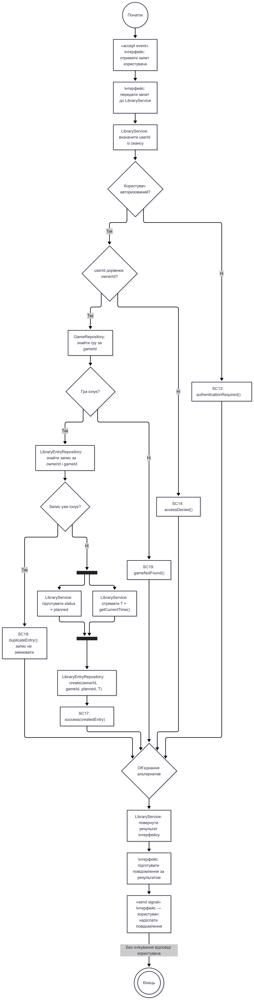

# Лабораторна №4 — Процес / поведінка

Тема: каталог відеоігор та бібліотека користувача.

Обраний процес: додавання гри до власної бібліотеки,
що деталізує UC07 із лабораторної №2.

Форма моделювання: Activity-діаграма
за допомогою Mermaid flowchart.

## Матеріали роботи

- [Специфікація](spec.md) — опис процесу, ролей,
  умов, паралельних дій і повідомлень.
- [Текст діаграми](model.mmd) — модель у Mermaid.
- [Зображення діаграми](model.png) — рендер моделі.
- [Аудит](audit.md) — результати перевірки
  та опис виправлень.
- [Захист](DEFENSE.md) — обґрунтування рішень
  і перевірка узгодженості.

## Опис процесу

Перед додаванням система перевіряє авторизацію,
власника бібліотеки, наявність гри та запису.

Якщо додавання дозволено і запис відсутній,
паралельно готуються початковий статус planned
і поточний час T. Після завершення обох дій
створюється LIBRARY_ENTRY.

Кожен передбачений результат завершується
повідомленням користувачу.
Підтвердження прочитання не очікується.

## Перегляд діаграми

## Зв’язок із попередніми лабораторними

- Lab1 — сутності USER, GAME та LIBRARY_ENTRY.
- Lab2 — UC07, UC10 і сценарії SC13, SC14, SC17–SC19.
- Lab3 — порядок перевірок, операції та результати
  взаємодії компонентів.