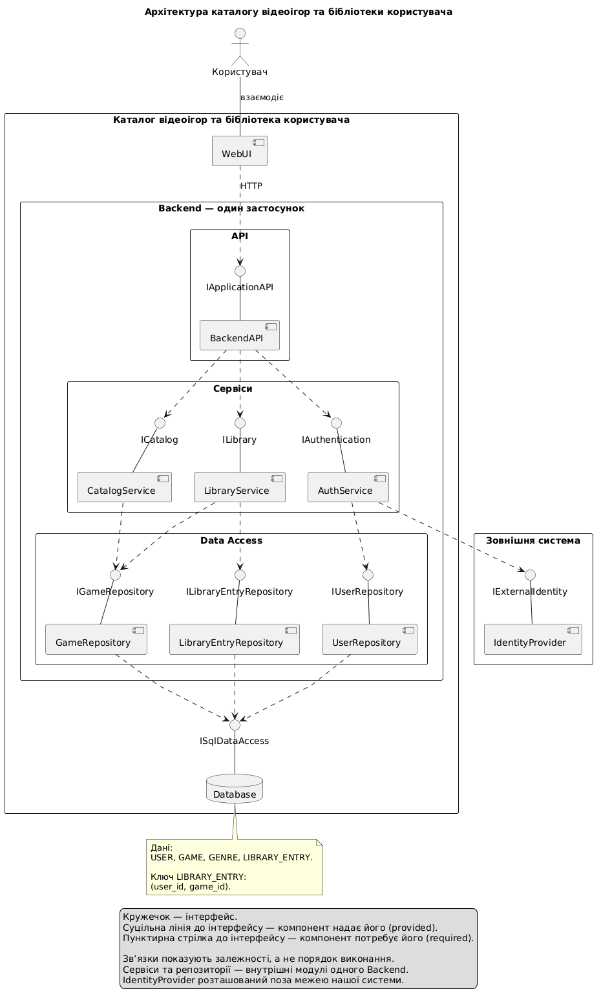

# Лабораторна №5 — Архітектура

Тема: каталог відеоігор та бібліотека користувача.

## Мета

Описати компоненти системи, їхні інтерфейси, залежності
та взаємодію із зовнішнім сервісом автентифікації.

## Матеріали

- [Специфікація архітектури](spec.md)
- [Код компонентної діаграми PlantUML](model.puml)
- [Зображення діаграми](model.png)
- [Аудит і трасування до попередніх моделей](audit.md)
- [Захист роботи та обґрунтування рішень](DEFENSE.md)

## Компонентна діаграма

## Організація системи

WebUI передає HTTP-запити до BackendAPI.

Backend є одним застосунком із внутрішніми модулями:
- CatalogService — перегляд каталогу, пошук і фільтрування.
- LibraryService — перевірка доступу та операції з бібліотекою.
- AuthService — автентифікація через зовнішній IdentityProvider.
- GameRepository, LibraryEntryRepository і UserRepository —
  доступ до даних.

Database зберігає USER, GAME, GENRE та LIBRARY_ENTRY.

На діаграмі показано інтерфейси, які компоненти надають
(provided) та потребують (required). Залежності показують
використання інтерфейсів, а не порядок виконання дій.

IdentityProvider розташований поза межею системи.
WebUI, Backend і Database належать до нашої системи.

## Зв’язок із попередніми лабораторними

- [Lab1](../Lab1/) — сутності, зв’язки та обмеження даних.
- [Lab2](../Lab2/) — вимоги, варіанти використання та сценарії.
- [Lab3](../Lab3/) — взаємодія учасників під час додавання гри.
- [Lab4](../Lab4/) — процес додавання гри та його альтернативні результати.

Детальне зіставлення наведено в audit.md та DEFENSE.md.